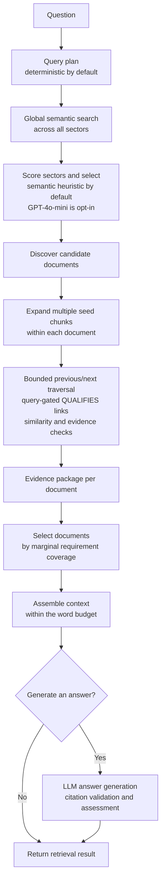

# Isthmus

Isthmus tests whether evidence near a semantically relevant passage can make
retrieval more complete than returning only the nearest chunks. It searches
globally, uses the hits as multiple seeds inside candidate documents, and
expands along bounded previous/next chunk links to find nearby supporting
evidence. It then groups evidence by document, ranks documents for
complementary support, and assembles a budgeted context for an optional cited
answer.

It is a research prototype, not a production-ready service or a proven
improvement over standard RAG. Retrieval can miss evidence, and citations do
not guarantee that an answer is correct.

## How retrieval works



Traversal follows sequential links in both directions from each seed. By
default, a neighboring chunk is included when its query similarity is at least
`0.62` or it supports a query requirement. Traversal is bounded and may cross
up to two low-similarity neighbors to avoid breaking a useful local path.
Exception queries may follow a `QUALIFIES` link extracted from nearby text with
an exception/qualification cue or an explicit exception heading. These
heuristic links are limited to nearby chunks in the same section, except that an
exception heading can connect across the heading to nearby text. They are
followed and included only when similarity reaches the separate `0.42`
`qualifies_threshold`; globally retrieved seeds remain included under the
ordinary seed rule. The links are not generated by an LLM and may miss more
complex relationships.

Document selection defaults to marginal requirement coverage rather than
filling the target count. After the first document, another is selected if it
adds a newly supported requirement or improves normalized requirement coverage
by at least `0.05`. The target of three documents is therefore not an obligation;
`max_selected_documents` remains the cap. The prior fixed-target policy remains
available for comparison with `document_selection_policy="fixed_target"`.

### Example: one bounded walk per seed

Suppose global search returns `C4`, `C20`, and `C40` from the same document.
The retriever starts a bounded BFS from every seed and follows only linked
neighbors that pass its traversal checks:

```text
C2 <-> C3 <-> C4(seed) <-> C5 <-> C6
C18 <-> C19 <-> C20(seed) <-> C21 <-> C22
C38 <-> C39 <-> C40(seed) <-> C41 <-> C42
```

These are three separate local walks, not a path connecting `C4`, `C20`, and
`C40`. A seed's nearby chunks can join its walk if they pass similarity or
requirement checks; walks overlap and deduplicate only if they reach the same
chunks within the traversal limits. The three seeds can still contribute
separately to the same document evidence package. An explicit `QUALIFIES` edge
can add a non-sequential link when present and when the query asks about
exceptions. All included evidence is then ranked and packed under the context
budget.

## Features

- PDF, DOCX, PPTX, XLSX, TXT, and Markdown ingestion (PDF OCR is not supported).
- SQLite persistence and local ChromaDB vector search.
- Bounded graph traversal, document reranking, and token-budgeted contexts.
- Streamlit UI, CLI, and local HTTP API.
- OpenAI-compatible embedding and answer endpoints; Anthropic Messages API for
  answer generation.

## Run locally

Requires Python 3.11 or newer. From PowerShell:

```powershell
git clone https://github.com/gahanlal/isthmus-rag.git
cd isthmus-rag
py -3.14 -m venv .venv
.\.venv\Scripts\Activate.ps1
python -m pip install -r requirements.txt
Copy-Item .env.example .env
python -m pytest
streamlit run frontend\streamlit_app.py
```

`requirements.txt` installs the core dependencies plus the development and UI
extras:

- Core: `openai`, `anthropic`, `pypdf`, `python-dotenv`, `python-docx`,
  `python-pptx`, `openpyxl`, `fastapi`, `uvicorn`, `python-multipart`,
  `chromadb`.
- Development: `pytest`.
- UI: `streamlit`.

The optional benchmark runner also needs `huggingface-hub`; install it with
`python -m pip install -e ".[evaluation]"`. Version constraints are maintained
in [`pyproject.toml`](pyproject.toml).

Set `ISTHMUS_EMBEDDING_MODEL` and `ISTHMUS_EMBEDDING_API_KEY` in `.env`, then
create a sector and upload documents in the UI. For generated answers, also
configure the answer provider and choose a model in the UI. Provider API calls
may incur charges; documents and questions are sent to the configured endpoint.
Never commit API keys.

Sector selection uses semantic scoring by default. To opt into LLM
sector routing, set `ISTHMUS_LLM_SECTOR_SELECTION=true` and configure
`OPENAI_API_KEY`. This makes a model request for each query and adds latency and
provider cost; the current benchmark found no meaningful retrieval gain, so it
is disabled by default.

For CLI PDF indexing and retrieval:

```powershell
isthmus index-pdfs --pdf-dir testfiles --sector "Research"
isthmus query "What does the report say about the project?"
```

The HTTP API runs locally with `python -m uvicorn isthmus.api:app`. It has no
authentication; do not expose it publicly.

## Evaluation

The matched-context retrieval evaluation used a token-aware local MiniLM index
over 77 PDFs from [Docugami KG-RAG-datasets](https://github.com/docugami/KG-RAG-datasets).
It evaluated 171 eligible SEC questions (195 total). Document-pattern precision,
recall and F1 are macro-averaged per question against the dataset's `Source Docs`
filename patterns; they measure document retrieval, not passage support.

For each question, top-k and document reranking were clipped to the same
whitespace-word count (the smaller available context). This controls for context
size within each policy comparison:

| Selection policy | Method | Precision | Recall | F1 | Mean context words | Median latency |
|---|---|---:|---:|---:|---:|---:|
| Fixed target | Top-k, size-matched | 29.2% | **98.2%** | 39.5% | 4,164 | 45.3 ms |
| Fixed target | Document reranking, size-matched | **43.7%** | 69.7% | **47.9%** | 4,164 | 116.5 ms |
| Marginal coverage | Top-k, size-matched | 37.2% | **94.0%** | **47.4%** | 1,811 | 49.7 ms |
| Marginal coverage | Document reranking, size-matched | **50.0%** | 32.7% | 36.0% | 1,811 | 112.6 ms |

At equal context size, fixed-target reranking gains **8.4 F1 points** over
top-k; its F1 gain is not explained only by returning less text. Under the new
marginal-coverage policy, document reranking trails size-matched top-k by
**11.4 F1 points**, with substantially lower recall. The policy comparison is
therefore not a blanket KPI improvement. Thresholds remain hand-set, and these
document labels still do not measure passage entailment.

### Seven-question LLM answer QA pilot

The answer model and a blinded judge (both GPT-4o-mini) evaluated top-k,
fixed-target and marginal-coverage answers using exactly the same per-question
word count. Reference facts and PDF page pointers are in
[`evaluation/docugami_passage_labels.json`](evaluation/docugami_passage_labels.json).

| Retrieval arm | Correctness (0–4) | Completeness (0–4) | Citation support (0–4) |
|---|---:|---:|---:|
| Top-k | 3.00 | 3.43 | 3.00 |
| Fixed target | 4.00 | 4.00 | 4.00 |
| Marginal coverage | 4.00 | 4.00 | 4.00 |

Fixed-target and marginal coverage tied on these rubric scores for all seven
questions. Each pipeline arm scored better than top-k on three questions and
tied on four. This is a small, assistant-authored pilot, not independent
validation: the labels were checked against cited PDF pages but not
independently reviewed, and the same model generated and judged answers. It
does not establish general answer-quality improvement or the impact of
`QUALIFIES` links; the seven questions are not a dedicated exception-query set.
The current qualifier extractor is heuristic.

See the [full benchmark and methodology](docs/docugami-evaluation.md), the
[passage-level QA review](docs/docugami-passage-review.md), and
[ingestion/index compatibility notes](docs/ingestion.md).

## Tests

Run the unit and integration test suite with:

```powershell
python -m pytest
```

The included sample evaluation labels are illustrative, not independently
reviewed. Review and update labels when using a different document index.
