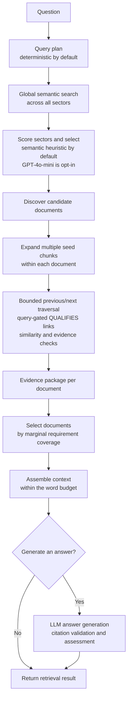

# Isthmus

Isthmus tests whether evidence near a semantically relevant passage can make
retrieval more complete than returning only the nearest chunks. It searches
globally, uses the hits as multiple seeds inside candidate documents, and
expands along bounded previous/next chunk links to find nearby supporting
evidence. It then groups evidence by document, ranks documents for
complementary support, and assembles a budgeted context for an optional cited
answer.

It is a research prototype, not a production-ready service or a proven
improvement over standard RAG. Retrieval can miss evidence, and citations do
not guarantee that an answer is correct.

## How retrieval works



Traversal follows sequential links in both directions from each seed. By
default, a neighboring chunk is included when its query similarity is at least
`0.62` or it supports a query requirement. Traversal is bounded and may cross
up to two low-similarity neighbors to avoid breaking a useful local path.
Exception queries may follow a `QUALIFIES` link extracted from nearby text with
an exception/qualification cue or an explicit exception heading. These
heuristic links are limited to nearby chunks in the same section, except that an
exception heading can connect across the heading to nearby text. They are
followed and included only when similarity reaches the separate `0.42`
`qualifies_threshold`; globally retrieved seeds remain included under the
ordinary seed rule. The links are not generated by an LLM and may miss more
complex relationships.

Document selection defaults to marginal requirement coverage rather than
filling the target count. After the first document, another is selected if it
adds a newly supported requirement or improves normalized requirement coverage
by at least `0.05`. The target of three documents is therefore not an obligation;
`max_selected_documents` remains the cap. The prior fixed-target policy remains
available for comparison with `document_selection_policy="fixed_target"`.

### Example: one bounded walk per seed

Suppose global search returns `C4`, `C20`, and `C40` from the same document.
The retriever starts a bounded BFS from every seed and follows only linked
neighbors that pass its traversal checks:

```text
C2 <-> C3 <-> C4(seed) <-> C5 <-> C6
C18 <-> C19 <-> C20(seed) <-> C21 <-> C22
C38 <-> C39 <-> C40(seed) <-> C41 <-> C42
```

These are three separate local walks, not a path connecting `C4`, `C20`, and
`C40`. A seed's nearby chunks can join its walk if they pass similarity or
requirement checks; walks overlap and deduplicate only if they reach the same
chunks within the traversal limits. The three seeds can still contribute
separately to the same document evidence package. An explicit `QUALIFIES` edge
can add a non-sequential link when present and when the query asks about
exceptions. All included evidence is then ranked and packed under the context
budget.

## Features

- PDF, DOCX, PPTX, XLSX, TXT, and Markdown ingestion (PDF OCR is not supported).
- SQLite persistence and local ChromaDB vector search.
- Bounded graph traversal, document reranking, and token-budgeted contexts.
- Streamlit UI, CLI, and local HTTP API.
- OpenAI-compatible embedding and answer endpoints; Anthropic Messages API for
  answer generation.

## Run locally

Requires Python 3.11 or newer. From PowerShell:

```powershell
git clone https://github.com/gahanlal/isthmus-rag.git
cd isthmus-rag
py -3.14 -m venv .venv
.\.venv\Scripts\Activate.ps1
python -m pip install -r requirements.txt
Copy-Item .env.example .env
python -m pytest
streamlit run frontend\streamlit_app.py
```

`requirements.txt` installs the core dependencies plus the development and UI
extras:

- Core: `openai`, `anthropic`, `pypdf`, `python-dotenv`, `python-docx`,
  `python-pptx`, `openpyxl`, `fastapi`, `uvicorn`, `python-multipart`,
  `chromadb`.
- Development: `pytest`.
- UI: `streamlit`.

The optional benchmark runner also needs `huggingface-hub`; install it with
`python -m pip install -e ".[evaluation]"`. Version constraints are maintained
in [`pyproject.toml`](pyproject.toml).

Set `ISTHMUS_EMBEDDING_MODEL` and `ISTHMUS_EMBEDDING_API_KEY` in `.env`, then
create a sector and upload documents in the UI. For generated answers, also
configure the answer provider and choose a model in the UI. Provider API calls
may incur charges; documents and questions are sent to the configured endpoint.
Never commit API keys.

Sector selection uses semantic scoring by default. To opt into LLM
sector routing, set `ISTHMUS_LLM_SECTOR_SELECTION=true` and configure
`OPENAI_API_KEY`. This makes a model request for each query and adds latency and
provider cost; the current benchmark found no meaningful retrieval gain, so it
is disabled by default.

For CLI PDF indexing and retrieval:

```powershell
isthmus index-pdfs --pdf-dir testfiles --sector "Research"
isthmus query "What does the report say about the project?"
```

The HTTP API runs locally with `python -m uvicorn isthmus.api:app`. It has no
authentication; do not expose it publicly.

## Evaluation

The latest retrieval benchmark used a token-aware local MiniLM index over 77
PDFs from [Docugami KG-RAG-datasets](https://github.com/docugami/KG-RAG-datasets).
It evaluated 171 eligible SEC questions (195 total). Metrics are
macro-averaged per-question document-pattern scores: retrieved document
filenames are matched against the dataset's `Source Docs` filename patterns.
It measures document retrieval, not passage support or answer correctness.

| Retrieval method | Precision | Recall | F1 | Median latency |
|---|---:|---:|---:|---:|
| Dense top-k | 29.3% | **98.2%** | 39.6% | 48.1 ms |
| Adaptive graph | 41.8% | 81.3% | **49.2%** | 94.6 ms |
| Heuristic sector routing + graph | 41.8% | 81.3% | **49.2%** | 92.0 ms |
| Full pipeline, heuristic sector selection | **42.9%** | 71.2% | 47.9% | 126.5 ms |
| Full pipeline, GPT-4o-mini sector selection | 42.9% | 71.2% | 47.9% | 1,491.3 ms |

Document-pattern F1 is the harmonic mean of document-set precision and recall
for each question, then macro-averaged across the 171 eligible questions. The
LLM selector made 171 successful calls but did not meaningfully improve these
retrieval scores; it added about 1.36 seconds to median latency. Accordingly,
LLM sector selection is opt-in, not the default.

### Separate seven-question passage review

A small manual review on the token-aware index found complete retrieved
evidence for **6/7** questions with the full pipeline and **5/7** with top-k.
This passage-level check is separate from the document-pattern KPI table: the
questions and judgments were assistant-authored, not independently reviewed,
and are too few to estimate general performance. The benchmark has no gold
answers or claim-level citation labels, so it does not measure answer
correctness or citation accuracy. Latencies are single-run measurements, not
production benchmarks.

See the [full benchmark and methodology](docs/docugami-evaluation.md), the
[passage review](docs/docugami-passage-review.md), and
[ingestion/index compatibility notes](docs/ingestion.md).

## Tests

Run the unit and integration test suite with:

```powershell
python -m pytest
```

The included sample evaluation labels are illustrative, not independently
reviewed. Review and update labels when using a different document index.
